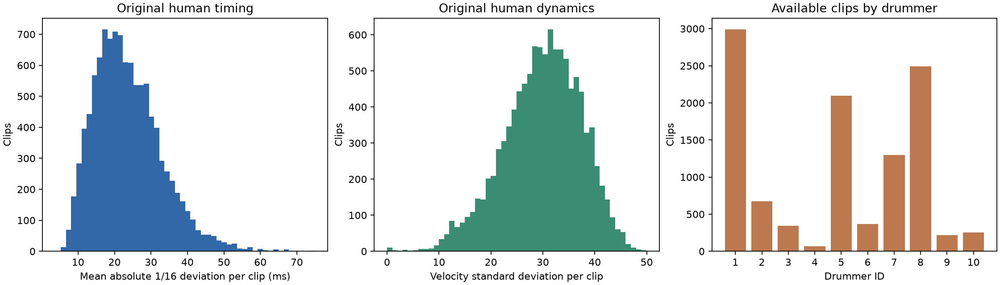

# Dataset checks - 11 October 2026

Both full builds completed successfully. These checks validate dataset construction; no classifier has been trained.

- Input: 1,150 GMD MIDI performances.
- Used: 577 performances from 10 drummers.
- Skipped: 573 performances; reasons: {'shorter than one clip': 573}.
- Human baseline: 10,804 two-bar clips.
- Matched table: 75,628 rows, with 10,804 rows per condition.
- Transformed full-performance MIDI exports: 3,462.
- Empty clips: 0.

- Automated synthetic tests: 36 passed.

## Transformation checks

- PASS: Human rows are identical between the two builds; every source clip has exactly seven uniquely identified versions.
- PASS: Source notes, clip boundaries, tempo, and metadata match across conditions. Timing-only conditions preserve all velocity features.
- PASS: The four 1/16 strengths reduce timing deviations by exactly 25%, 50%, 75%, and 100% (within 1e-12 seconds).
- PASS: Velocity normalization leaves every timing and IOI feature unchanged and sets velocity mean/std/range to 80/0/0.
- PASS: Fully quantized notes lie on their intended grid. No infinite feature values or missing drummer/style/split metadata were found.
- PASS: All 3,462 exported MIDI files preserve note-on counts, pitches, and the intended velocity/timing changes, allowing native half-tick rounding.
- PASS: The loader retains 796 raw drum note-ons across 204 usable source files that the original duration-based reader omitted.

## Feature summary

Timing values below are means of the per-clip absolute-deviation features, not note-weighted means. Velocity SD is also averaged across clips.

| Condition | Rows | 1/16 deviation (ms) | 1/32 deviation (ms) | Velocity SD | Missing IOI rows |
| --- | ---: | ---: | ---: | ---: | ---: |
| human | 10,804 | 23.6701 | 16.0119 | 29.9253 | 0 |
| quantized_16_25 | 10,804 | 17.7525 | 15.4485 | 29.9253 | 0 |
| quantized_16_50 | 10,804 | 11.8350 | 11.8350 | 29.9253 | 0 |
| quantized_16_75 | 10,804 | 5.9175 | 5.9175 | 29.9253 | 0 |
| quantized_16_100 | 10,804 | 0.0000 | 0.0000 | 29.9253 | 0 |
| quantized_32_100 | 10,804 | 18.2568 | 0.0000 | 29.9253 | 0 |
| velocity_normalized | 10,804 | 23.6701 | 16.0119 | 0.0000 | 0 |

## Human baseline inspection

| Feature | Minimum | Median | Maximum |
| --- | ---: | ---: | ---: |
| note_count | 3 | 39 | 110 |
| timing_abs_mean | 0.00383185 | 0.0223714 | 0.0749432 |
| timing_std | 0.00441487 | 0.0226764 | 0.0887402 |
| ioi_mean | 0.0364869 | 0.108131 | 1.12039 |
| ioi_std | 0.00718535 | 0.0864656 | 0.76257 |
| velocity_mean | 9.33333 | 68.1087 | 127 |
| velocity_std | 0 | 30.4312 | 49.9265 |
| velocity_range | 0 | 107 | 124 |
| timing_32_abs_mean | 0.00383185 | 0.0154834 | 0.0402452 |
| timing_32_std | 0.00441487 | 0.0170118 | 0.0426676 |

| Drummer | Clips | Used performances |
| --- | ---: | ---: |
| drummer1 | 2,991 | 104 |
| drummer2 | 676 | 13 |
| drummer3 | 343 | 78 |
| drummer4 | 66 | 9 |
| drummer5 | 2,095 | 54 |
| drummer6 | 367 | 15 |
| drummer7 | 1,300 | 184 |
| drummer8 | 2,494 | 80 |
| drummer9 | 218 | 30 |
| drummer10 | 254 | 10 |

## Interpretation and limits

- The expected timing and velocity transformations are present. This does not yet establish classification accuracy or a detectability threshold.
- Two-bar clipping excludes many short fills. The resulting dataset represents usable two-bar passages rather than every original performance.
- Drummer coverage is uneven; keep related versions together and evaluate on held-out drummers when model training is added.
- Human timing is measured against straight grids. Swing, triplets, and intentional timing patterns can contribute to the measured deviations; no style filtering was applied.
- IOIs pool all drums. Exact simultaneous notes merge into one onset event, so quantization can change the number of distinct events while preserving all note-on events.
- Timing-only conditions retain velocities. The velocity-only condition retains timing. All conditions retain original clip membership.
- Feature tables retain fractional-tick partial quantization in memory; exported MIDI rounds to the original 480 ticks per quarter note.
- Raw drum note-ons omitted by the duration parser are restored with original timing/velocity and zero duration. These percussive events remain valid for onset-based features; note duration is not a classifier feature.

## Outputs in the project

- `results/DATASET_CHECKS.md` (tracked summary)
- `results/dataset_checks.png` (tracked plot)
- `data/features/human_features.csv`
- `data/features/conditions_features.csv`
- `data/features/human_features_skipped.csv`
- `data/features/conditions_features_skipped.csv`
- `data/generated/<condition>/<source_file>`
- `CODE_EXPLAINER.md`

Run environment: Python 3.12.14, NumPy 2.5.4, pandas 3.0.6, mido 1.3.3.
