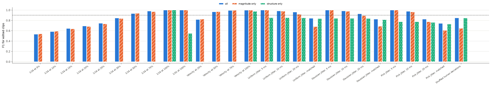
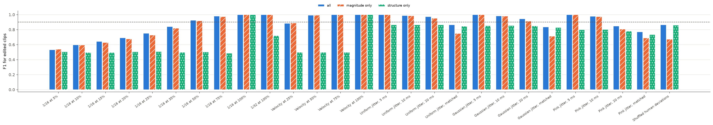

# Feature ablation (RQ3)

Generated by `env/bin/python -m src.run_ablation`. Same leave-one-drummer-out protocol as `results/experiments/`, with different feature sets. Cells are F1 for edited clips, mean over held-out drummers. Context features (tempo, note count) are in every set.

A feature set that cannot separate the classes at all makes a model predict one class for everything: F1 is then 0 (or about 0.67), while accuracy is 0.5. Structure features are unchanged by partial quantization, so "structure only" is at that floor there by construction. Accuracy is in `ablation_metrics.csv`.

At full 1/16 quantization and full velocity normalization, "structure only" still scores high: a clip without timing (or velocity) spread gets structure values of 0 by convention, which itself reveals the edit. That is a sanity check, not evidence of structure.

Per-instrument timing and IOI features are listed as magnitude, but they also depend on which notes have which deviation. This is why "magnitude only" is above chance on the shuffled control, whose overall deviation sizes are identical to the human clip.

Feature groups:

- `mag_timing`: `mag_timing_abs_mean`, `mag_timing_std`, `mag_timing32_abs_mean`, `mag_timing32_std`, `mag_kick_timing_abs_mean`, `mag_snare_timing_abs_mean`, `mag_hihat_timing_abs_mean`
- `mag_ioi`: `mag_ioi_mean`, `mag_ioi_std`
- `mag_velocity`: `mag_velocity_mean`, `mag_velocity_std`, `mag_velocity_range`
- `struct_timing`: `struct_timing_autocorr`, `struct_timing_position_r2`, `struct_timing_instrument_r2`, `struct_chord_spread_ratio`
- `struct_velocity`: `struct_velocity_position_r2`

## Logistic regression

### Magnitude versus structure

| Condition | all | magnitude only | structure only |
| --- | ---: | ---: | ---: |
| 1/16 at 5% | 0.531 | 0.540 | 0.000 |
| 1/16 at 10% | 0.583 | 0.589 | 0.000 |
| 1/16 at 15% | 0.642 | 0.635 | 0.000 |
| 1/16 at 20% | 0.691 | 0.681 | 0.000 |
| 1/16 at 25% | 0.743 | 0.732 | 0.000 |
| 1/16 at 35% | 0.845 | 0.835 | 0.000 |
| 1/16 at 50% | 0.932 | 0.937 | 0.000 |
| 1/16 at 75% | 0.980 | 0.967 | 0.000 |
| 1/16 at 100% | 1.000 | 1.000 | 0.998 |
| 1/32 at 100% | 1.000 | 1.000 | 0.546 |
| Velocity at 25% | 0.817 | 0.824 | 0.000 |
| Velocity at 50% | 0.967 | 0.967 | 0.000 |
| Velocity at 75% | 0.993 | 0.994 | 0.000 |
| Velocity at 100% | 0.997 | 0.997 | 0.976 |
| Uniform jitter, 5 ms | 0.999 | 0.999 | 0.852 |
| Uniform jitter, 10 ms | 0.982 | 0.977 | 0.852 |
| Uniform jitter, 20 ms | 0.961 | 0.918 | 0.851 |
| Uniform jitter, matched | 0.841 | 0.680 | 0.833 |
| Gaussian jitter, 5 ms | 0.999 | 0.999 | 0.838 |
| Gaussian jitter, 10 ms | 0.982 | 0.976 | 0.838 |
| Gaussian jitter, 20 ms | 0.927 | 0.892 | 0.835 |
| Gaussian jitter, matched | 0.822 | 0.686 | 0.814 |
| Pink jitter, 5 ms | 1.000 | 0.999 | 0.772 |
| Pink jitter, 10 ms | 0.976 | 0.964 | 0.773 |
| Pink jitter, 20 ms | 0.823 | 0.773 | 0.761 |
| Pink jitter, matched | 0.742 | 0.606 | 0.729 |
| Shuffled human deviations | 0.847 | 0.644 | 0.845 |



### Change in F1 when one group is removed

| Condition | mag_timing | mag_ioi | mag_velocity | struct_timing | struct_velocity |
| --- | ---: | ---: | ---: | ---: | ---: |
| 1/16 at 5% | -0.077 | -0.002 | +0.002 | +0.005 | +0.000 |
| 1/16 at 10% | -0.123 | +0.000 | -0.000 | +0.008 | +0.006 |
| 1/16 at 15% | -0.171 | -0.001 | -0.001 | -0.004 | -0.000 |
| 1/16 at 20% | -0.201 | +0.000 | -0.000 | -0.004 | +0.002 |
| 1/16 at 25% | -0.242 | -0.001 | +0.003 | -0.009 | -0.005 |
| 1/16 at 35% | -0.310 | +0.001 | +0.005 | -0.010 | -0.002 |
| 1/16 at 50% | -0.358 | -0.000 | +0.006 | -0.000 | +0.003 |
| 1/16 at 75% | -0.270 | -0.002 | -0.001 | -0.013 | -0.001 |
| 1/16 at 100% | -0.002 | -0.000 | +0.000 | -0.000 | +0.000 |
| 1/32 at 100% | -0.447 | +0.000 | -0.001 | +0.000 | +0.000 |
| Velocity at 25% | +0.008 | +0.003 | -0.817 | +0.005 | +0.004 |
| Velocity at 50% | +0.001 | +0.002 | -0.967 | +0.000 | -0.000 |
| Velocity at 75% | +0.001 | +0.000 | -0.993 | +0.000 | +0.000 |
| Velocity at 100% | +0.001 | +0.001 | -0.021 | -0.000 | +0.000 |
| Uniform jitter, 5 ms | -0.103 | -0.000 | +0.000 | +0.000 | -0.000 |
| Uniform jitter, 10 ms | -0.108 | -0.001 | -0.001 | -0.005 | +0.000 |
| Uniform jitter, 20 ms | -0.106 | -0.001 | +0.000 | -0.043 | -0.000 |
| Uniform jitter, matched | -0.001 | -0.005 | -0.002 | -0.162 | -0.000 |
| Gaussian jitter, 5 ms | -0.117 | +0.000 | -0.000 | -0.000 | -0.000 |
| Gaussian jitter, 10 ms | -0.121 | -0.001 | +0.002 | -0.007 | -0.000 |
| Gaussian jitter, 20 ms | -0.089 | -0.000 | +0.000 | -0.035 | +0.001 |
| Gaussian jitter, matched | -0.001 | +0.001 | -0.000 | -0.134 | +0.001 |
| Pink jitter, 5 ms | -0.156 | +0.000 | -0.000 | -0.001 | -0.000 |
| Pink jitter, 10 ms | -0.138 | -0.001 | +0.002 | -0.014 | -0.002 |
| Pink jitter, 20 ms | -0.054 | +0.002 | +0.007 | -0.055 | -0.001 |
| Pink jitter, matched | -0.003 | -0.003 | -0.002 | -0.135 | -0.000 |
| Shuffled human deviations | +0.000 | -0.003 | -0.001 | -0.203 | -0.001 |

## Random forest

### Magnitude versus structure

| Condition | all | magnitude only | structure only |
| --- | ---: | ---: | ---: |
| 1/16 at 5% | 0.532 | 0.538 | 0.506 |
| 1/16 at 10% | 0.596 | 0.593 | 0.496 |
| 1/16 at 15% | 0.642 | 0.627 | 0.495 |
| 1/16 at 20% | 0.690 | 0.677 | 0.505 |
| 1/16 at 25% | 0.751 | 0.727 | 0.508 |
| 1/16 at 35% | 0.839 | 0.818 | 0.498 |
| 1/16 at 50% | 0.924 | 0.917 | 0.502 |
| 1/16 at 75% | 0.980 | 0.974 | 0.485 |
| 1/16 at 100% | 1.000 | 1.000 | 1.000 |
| 1/32 at 100% | 1.000 | 1.000 | 0.721 |
| Velocity at 25% | 0.884 | 0.889 | 0.498 |
| Velocity at 50% | 0.991 | 0.991 | 0.498 |
| Velocity at 75% | 0.998 | 0.998 | 0.498 |
| Velocity at 100% | 0.999 | 0.999 | 0.999 |
| Uniform jitter, 5 ms | 1.000 | 1.000 | 0.863 |
| Uniform jitter, 10 ms | 0.988 | 0.986 | 0.863 |
| Uniform jitter, 20 ms | 0.972 | 0.952 | 0.864 |
| Uniform jitter, matched | 0.864 | 0.749 | 0.844 |
| Gaussian jitter, 5 ms | 1.000 | 1.000 | 0.854 |
| Gaussian jitter, 10 ms | 0.983 | 0.980 | 0.854 |
| Gaussian jitter, 20 ms | 0.944 | 0.913 | 0.849 |
| Gaussian jitter, matched | 0.837 | 0.714 | 0.828 |
| Pink jitter, 5 ms | 0.999 | 0.999 | 0.800 |
| Pink jitter, 10 ms | 0.977 | 0.973 | 0.801 |
| Pink jitter, 20 ms | 0.847 | 0.807 | 0.781 |
| Pink jitter, matched | 0.770 | 0.688 | 0.735 |
| Shuffled human deviations | 0.865 | 0.671 | 0.860 |



### Change in F1 when one group is removed

| Condition | mag_timing | mag_ioi | mag_velocity | struct_timing | struct_velocity |
| --- | ---: | ---: | ---: | ---: | ---: |
| 1/16 at 5% | -0.053 | +0.009 | +0.019 | +0.014 | -0.000 |
| 1/16 at 10% | -0.101 | +0.003 | +0.002 | -0.005 | -0.005 |
| 1/16 at 15% | -0.132 | -0.000 | +0.005 | -0.010 | -0.004 |
| 1/16 at 20% | -0.167 | +0.008 | +0.003 | -0.007 | -0.001 |
| 1/16 at 25% | -0.222 | -0.000 | +0.004 | -0.023 | -0.003 |
| 1/16 at 35% | -0.282 | +0.004 | +0.001 | -0.019 | -0.001 |
| 1/16 at 50% | -0.312 | +0.003 | +0.006 | -0.008 | +0.002 |
| 1/16 at 75% | -0.236 | -0.001 | +0.000 | -0.005 | -0.000 |
| 1/16 at 100% | +0.000 | +0.000 | +0.000 | +0.000 | +0.000 |
| 1/32 at 100% | -0.265 | +0.000 | +0.000 | +0.000 | +0.000 |
| Velocity at 25% | +0.005 | +0.005 | -0.380 | +0.003 | +0.001 |
| Velocity at 50% | +0.001 | +0.000 | -0.488 | -0.000 | +0.000 |
| Velocity at 75% | +0.001 | +0.001 | -0.495 | -0.000 | +0.000 |
| Velocity at 100% | +0.000 | +0.000 | -0.000 | +0.000 | -0.000 |
| Uniform jitter, 5 ms | -0.084 | +0.000 | +0.000 | +0.000 | +0.000 |
| Uniform jitter, 10 ms | -0.100 | -0.000 | -0.000 | -0.002 | -0.000 |
| Uniform jitter, 20 ms | -0.102 | -0.004 | -0.003 | -0.020 | -0.001 |
| Uniform jitter, matched | -0.016 | -0.009 | -0.001 | -0.117 | -0.002 |
| Gaussian jitter, 5 ms | -0.092 | +0.000 | +0.000 | -0.000 | +0.000 |
| Gaussian jitter, 10 ms | -0.107 | +0.000 | +0.001 | -0.004 | +0.001 |
| Gaussian jitter, 20 ms | -0.090 | +0.001 | +0.001 | -0.032 | +0.000 |
| Gaussian jitter, matched | -0.002 | -0.003 | -0.000 | -0.125 | +0.004 |
| Pink jitter, 5 ms | -0.123 | +0.000 | +0.000 | -0.000 | +0.000 |
| Pink jitter, 10 ms | -0.109 | +0.001 | +0.001 | -0.005 | -0.002 |
| Pink jitter, 20 ms | -0.043 | -0.000 | -0.001 | -0.036 | +0.002 |
| Pink jitter, matched | -0.022 | -0.003 | +0.003 | -0.086 | +0.008 |
| Shuffled human deviations | -0.003 | -0.002 | +0.003 | -0.198 | +0.001 |

## Logistic-regression coefficients (all features)

Mean standardized coefficient over held-out-drummer folds. Positive values push toward "edited". Coefficients of correlated features share weight, so read them together with the ablation above.

| Feature | quantize_16_25 | quantize_16_50 | velocity_25 | humanize_uniform_matched | humanize_gaussian_matched | humanize_pink_matched | deviations_shuffled |
| --- | ---: | ---: | ---: | ---: | ---: | ---: | ---: |
| `tempo` | +0.42 | +0.49 | -0.31 | +0.12 | +0.21 | +0.66 | -0.05 |
| `note_count` | +0.09 | +0.61 | +0.04 | -0.80 | -0.77 | -0.26 | -0.59 |
| `mag_timing_abs_mean` | -4.06 | -22.85 | -0.33 | -0.12 | -0.57 | -0.50 | +0.52 |
| `mag_timing_std` | +0.43 | -0.14 | +0.22 | +0.35 | +0.35 | +0.60 | +0.12 |
| `mag_timing32_abs_mean` | +3.34 | +13.50 | +0.04 | -0.02 | -0.09 | -0.12 | -0.03 |
| `mag_timing32_std` | -0.36 | -1.18 | +0.17 | +0.84 | +1.14 | +0.79 | +0.18 |
| `mag_kick_timing_abs_mean` | -0.21 | -0.68 | +0.23 | -0.16 | -0.13 | -0.03 | -0.19 |
| `mag_snare_timing_abs_mean` | -0.27 | -0.25 | +0.03 | -0.29 | -0.27 | -0.23 | -0.36 |
| `mag_hihat_timing_abs_mean` | -0.00 | -0.21 | -0.10 | -0.22 | -0.20 | -0.03 | -0.23 |
| `mag_ioi_mean` | +0.08 | +0.11 | -0.76 | -0.68 | -0.64 | +0.09 | -0.44 |
| `mag_ioi_std` | -0.05 | +0.30 | +0.28 | +0.45 | +0.43 | +0.21 | +0.39 |
| `mag_velocity_mean` | -0.16 | -0.47 | +0.50 | +0.18 | +0.16 | +0.03 | +0.12 |
| `mag_velocity_std` | -0.01 | +0.13 | -0.19 | -0.23 | -0.25 | -0.07 | -0.14 |
| `mag_velocity_range` | +0.08 | +0.15 | -2.26 | -0.03 | -0.01 | +0.01 | -0.04 |
| `struct_timing_autocorr` | -0.17 | -0.22 | -0.21 | -1.31 | -1.30 | +0.32 | -1.41 |
| `struct_timing_position_r2` | +0.44 | +0.74 | -0.20 | -1.85 | -1.68 | -1.33 | -2.35 |
| `struct_timing_instrument_r2` | -0.17 | -0.17 | -0.02 | -0.75 | -0.76 | -0.74 | -0.73 |
| `struct_chord_spread_ratio` | +0.04 | -0.13 | +0.05 | +1.08 | +1.02 | +0.10 | +0.98 |
| `struct_velocity_position_r2` | -0.19 | -0.39 | +0.07 | +0.17 | +0.14 | +0.04 | +0.19 |

## Reproduce

```bash
env/bin/python -m src.run_ablation
```
