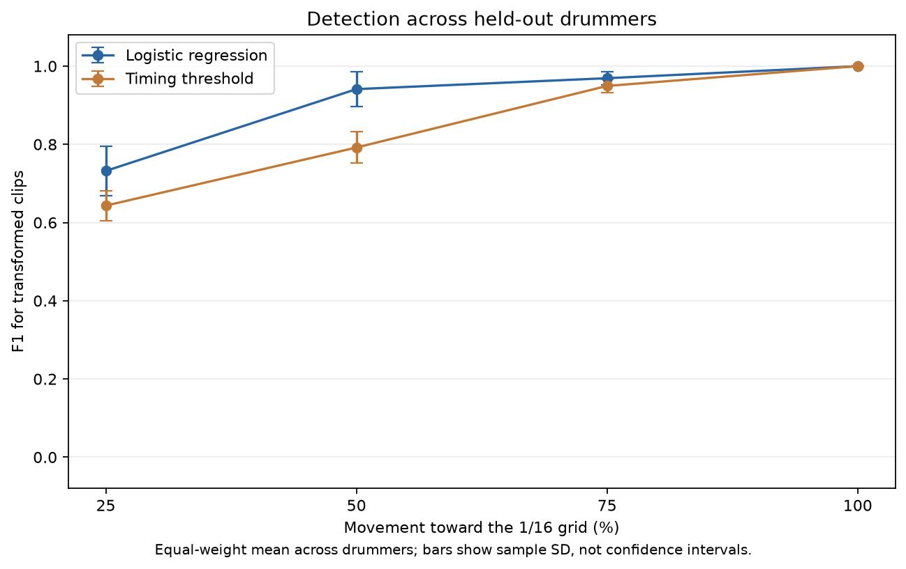
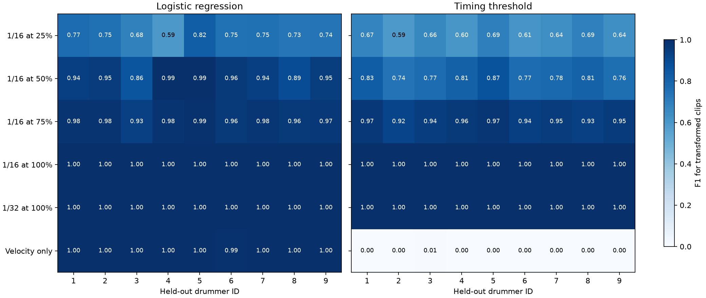
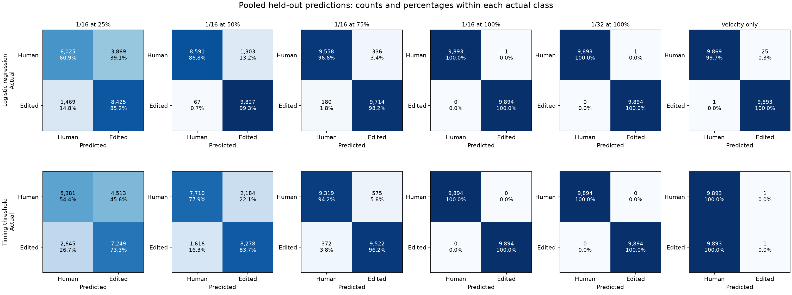

# Baseline classifier results

Run: 2026-10-19T13:46:42+02:00.

## Method

Six separate balanced binary experiments compare original clips with one edited condition at a time. Edited clips are the positive class (1); human clips are class 0.

Each experiment has 19,788 clips. Leave-one-drummer-out evaluation trains on 8 drummers and tests on the remaining drummer, repeating for all 9 drummers. Every row is tested exactly once per experiment and method. All versions of a clip, and all clips from a performance, stay with their drummer.

- Logistic regression uses the 10 existing numerical features, StandardScaler fitted only on the training fold, and fixed settings: C=1, lbfgs, max_iter=2000, seed=42. The probability decision threshold is 0.5. No hyperparameter search or test-driven feature selection was performed.
- The timing rule predicts an edit when mean absolute grid deviation is at or below a cutoff chosen only from training rows. The cutoff maximizes balanced accuracy; tied objectives choose the lowest cutoff. It uses the 1/16 deviation for the four 1/16 experiments and the velocity-only control, and the 1/32 deviation for the 1/32 experiment.
- Both methods receive only rhythmic features. IDs, drummer labels, original GMD split labels, condition names, and transformation settings are excluded from classifier inputs.
- These drummer-held-out folds replace the supplied GMD split for this experiment. There is no additional untouched test cohort; these results evaluate the fixed baseline protocol.

## Equal-weight scores across drummers

Each drummer contributes equally below. Values are mean ± sample standard deviation across held-out drummers; this spread is not a confidence interval. Precision, recall, and F1 refer to edited clips. Precision and F1 are recorded as 0 when no positive clips are predicted.

| Condition | Method | Accuracy | Precision | Recall | F1 |
| --- | --- | ---: | ---: | ---: | ---: |
| 1/16 at 25% | Logistic regression | 0.715 ± 0.057 | 0.696 ± 0.068 | 0.789 ± 0.119 | 0.732 ± 0.063 |
| 1/16 at 25% | Timing threshold | 0.634 ± 0.020 | 0.631 ± 0.036 | 0.669 ± 0.109 | 0.643 ± 0.038 |
| 1/16 at 50% | Logistic regression | 0.936 ± 0.050 | 0.901 ± 0.077 | 0.989 ± 0.018 | 0.941 ± 0.044 |
| 1/16 at 50% | Timing threshold | 0.793 ± 0.039 | 0.805 ± 0.067 | 0.789 ± 0.086 | 0.792 ± 0.040 |
| 1/16 at 75% | Logistic regression | 0.969 ± 0.017 | 0.973 ± 0.028 | 0.966 ± 0.025 | 0.969 ± 0.017 |
| 1/16 at 75% | Timing threshold | 0.949 ± 0.017 | 0.954 ± 0.041 | 0.948 ± 0.045 | 0.949 ± 0.017 |
| 1/16 at 100% | Logistic regression | 1.000 ± 0.000 | 1.000 ± 0.001 | 1.000 ± 0.000 | 1.000 ± 0.000 |
| 1/16 at 100% | Timing threshold | 1.000 ± 0.000 | 1.000 ± 0.000 | 1.000 ± 0.000 | 1.000 ± 0.000 |
| 1/32 at 100% | Logistic regression | 1.000 ± 0.000 | 1.000 ± 0.001 | 1.000 ± 0.000 | 1.000 ± 0.000 |
| 1/32 at 100% | Timing threshold | 1.000 ± 0.000 | 1.000 ± 0.000 | 1.000 ± 0.000 | 1.000 ± 0.000 |
| Velocity only | Logistic regression | 0.998 ± 0.004 | 0.997 ± 0.007 | 1.000 ± 0.000 | 0.998 ± 0.004 |
| Velocity only | Timing threshold | 0.500 ± 0.000 | 0.056 ± 0.167 | 0.000 ± 0.001 | 0.001 ± 0.002 |

## Pooled scores

These metrics pool all held-out predictions. Drummers with more clips have more influence here; compare with the equal-weight scores above.

| Condition | Method | Accuracy | Precision | Recall | F1 | TN | FP | FN | TP |
| --- | --- | ---: | ---: | ---: | ---: | ---: | ---: | ---: | ---: |
| 1/16 at 25% | Logistic regression | 0.730 | 0.685 | 0.852 | 0.759 | 6,025 | 3,869 | 1,469 | 8,425 |
| 1/16 at 25% | Timing threshold | 0.638 | 0.616 | 0.733 | 0.669 | 5,381 | 4,513 | 2,645 | 7,249 |
| 1/16 at 50% | Logistic regression | 0.931 | 0.883 | 0.993 | 0.935 | 8,591 | 1,303 | 67 | 9,827 |
| 1/16 at 50% | Timing threshold | 0.808 | 0.791 | 0.837 | 0.813 | 7,710 | 2,184 | 1,616 | 8,278 |
| 1/16 at 75% | Logistic regression | 0.974 | 0.967 | 0.982 | 0.974 | 9,558 | 336 | 180 | 9,714 |
| 1/16 at 75% | Timing threshold | 0.952 | 0.943 | 0.962 | 0.953 | 9,319 | 575 | 372 | 9,522 |
| 1/16 at 100% | Logistic regression | 1.000 | 1.000 | 1.000 | 1.000 | 9,893 | 1 | 0 | 9,894 |
| 1/16 at 100% | Timing threshold | 1.000 | 1.000 | 1.000 | 1.000 | 9,894 | 0 | 0 | 9,894 |
| 1/32 at 100% | Logistic regression | 1.000 | 1.000 | 1.000 | 1.000 | 9,893 | 1 | 0 | 9,894 |
| 1/32 at 100% | Timing threshold | 1.000 | 1.000 | 1.000 | 1.000 | 9,894 | 0 | 0 | 9,894 |
| Velocity only | Logistic regression | 0.999 | 0.997 | 1.000 | 0.999 | 9,869 | 25 | 1 | 9,893 |
| Velocity only | Timing threshold | 0.500 | 0.500 | 0.000 | 0.000 | 9,893 | 1 | 9,893 | 1 |

## Figures



The 1/32 grid and velocity-only condition are separate experiments and are not points on the 1/16 strength curve.





## Checks and interpretation

- All source clips have exactly one row for each of the seven conditions. Features are finite and matching versions have consistent drummer, source file, and note count.
- Training and test drummers, source performances, and source clip IDs are disjoint in every fold. Stored held-out predictions have exactly one row per clip, method, and experiment.
- The velocity-only timing control must have 50% accuracy because each human/edited pair has identical timing. Its F1 need not be 0.5: F1 depends on which class receives the predictions, and a tied training cutoff can yield no positive predictions.
- Full grid snapping and constant velocity leave direct signatures in the selected features. At 50% or stronger movement to the 1/16 grid, a geometric relation between the 1/16 and 1/32 deviation features can also help the classifier. High scores measure detection of these synthetic edits, not general authorship or listener judgments.
- Results apply to the retained two-bar GMD subset, including straight, swung, and triplet patterns. The original short-clip exclusions and uneven drummer coverage still apply.
- No formal numerical reliability criterion was fixed for this run. Scores and their drummer-to-drummer variation are reported without declaring a universal detectability threshold.

## Reproduce and inspect

From the project root:

```bash
env/bin/python -m src.train_baseline
```

- `metrics.csv`: pooled metrics plus equal-weight drummer means and SDs.
- `fold_metrics.csv`: each held-out drummer, training drummer IDs, learned timing cutoff, and confusion counts.
- `run_config.json`: fixed settings, input-table SHA-256, feature list, and package versions.
- `data/features/baseline_predictions.csv` in the project: full held-out labels/predictions, kept outside Git with other generated data when using the default path.

Input SHA-256: `639e51523e5019366ae4f8108e48a682041f2c3051cb43a253d2303229441aeb`.
