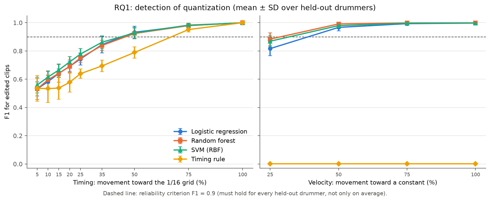
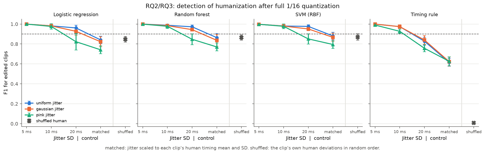
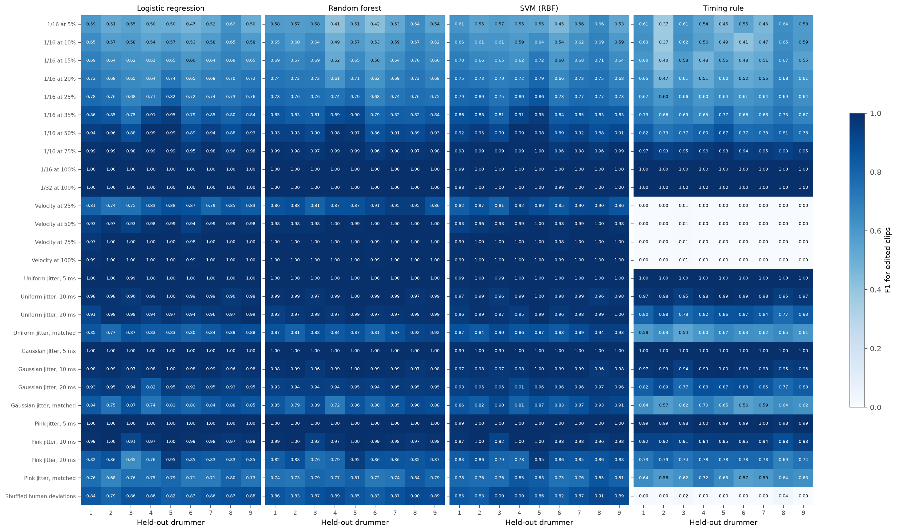

# Experiment results

Generated by `env/bin/python -m src.run_experiments` on 2026-10-20T11:44:18+02:00.

## Protocol

- 9,621 two-bar clips from 9 drummers; 27 edited conditions, each its own balanced task (human version = class 0, edited version of the same clips = class 1).
- Leave-one-drummer-out: every model is trained on all drummers but one and tested on the held-out drummer, for each drummer. All versions of a clip stay with their drummer.
- Fixed model settings (no hyperparameter search); missing-value filling and scaling are fitted on the training fold only. Inputs are the context and feature columns listed in `run_config.json`; IDs, drummer, style and condition settings never enter a model.
- **Reliable** (✓) means F1 ≥ 0.9 for every held-out drummer. This criterion was fixed before this run.

Cells: F1 for the edited class, mean ± SD over held-out drummers (each drummer weighted equally), and the lowest single-drummer F1. Pooled metrics and confusion counts are in `metrics.csv`; per-drummer results in `fold_metrics.csv`.

## RQ1: quantization (timing)

| Condition | Logistic regression | Random forest | SVM (RBF) | Timing rule |
| --- | ---: | ---: | ---: | ---: |
| 1/16 at 5% | 0.531 ± 0.049 (min 0.47) | 0.532 ± 0.075 (min 0.41) | 0.559 ± 0.056 (min 0.45) | 0.535 ± 0.091 (min 0.37) |
| 1/16 at 10% | 0.583 ± 0.042 (min 0.53) | 0.596 ± 0.058 (min 0.49) | 0.615 ± 0.043 (min 0.54) | 0.534 ± 0.100 (min 0.37) |
| 1/16 at 15% | 0.642 ± 0.030 (min 0.60) | 0.642 ± 0.062 (min 0.52) | 0.665 ± 0.042 (min 0.60) | 0.537 ± 0.078 (min 0.40) |
| 1/16 at 20% | 0.691 ± 0.037 (min 0.64) | 0.690 ± 0.047 (min 0.61) | 0.722 ± 0.039 (min 0.66) | 0.578 ± 0.070 (min 0.47) |
| 1/16 at 25% | 0.743 ± 0.043 (min 0.68) | 0.751 ± 0.032 (min 0.68) | 0.778 ± 0.040 (min 0.73) | 0.639 ± 0.033 (min 0.60) |
| 1/16 at 35% | 0.845 ± 0.059 (min 0.75) | 0.839 ± 0.036 (min 0.79) | 0.862 ± 0.045 (min 0.81) | 0.694 ± 0.040 (min 0.65) |
| 1/16 at 50% | 0.932 ± 0.043 (min 0.88) | 0.924 ± 0.038 (min 0.86) | 0.928 ± 0.040 (min 0.88) | 0.789 ± 0.040 (min 0.73) |
| 1/16 at 75% | 0.980 ± 0.015 (min 0.95) ✓ | 0.980 ± 0.012 (min 0.96) ✓ | 0.983 ± 0.014 (min 0.96) ✓ | 0.951 ± 0.017 (min 0.93) ✓ |
| 1/16 at 100% | 1.000 ± 0.000 (min 1.00) ✓ | 1.000 ± 0.000 (min 1.00) ✓ | 0.998 ± 0.004 (min 0.99) ✓ | 1.000 ± 0.000 (min 1.00) ✓ |
| 1/32 at 100% | 1.000 ± 0.000 (min 1.00) ✓ | 1.000 ± 0.000 (min 1.00) ✓ | 0.996 ± 0.006 (min 0.98) ✓ | 1.000 ± 0.000 (min 1.00) ✓ |



## RQ1: velocity normalization

| Condition | Logistic regression | Random forest | SVM (RBF) | Timing rule |
| --- | ---: | ---: | ---: | ---: |
| Velocity at 25% | 0.817 ± 0.049 (min 0.74) | 0.884 ± 0.045 (min 0.81) | 0.869 ± 0.038 (min 0.81) | 0.001 ± 0.002 (min 0.00) |
| Velocity at 50% | 0.967 ± 0.025 (min 0.93) ✓ | 0.991 ± 0.009 (min 0.98) ✓ | 0.979 ± 0.021 (min 0.93) ✓ | 0.001 ± 0.002 (min 0.00) |
| Velocity at 75% | 0.993 ± 0.012 (min 0.97) ✓ | 0.998 ± 0.003 (min 0.99) ✓ | 0.996 ± 0.006 (min 0.98) ✓ | 0.001 ± 0.002 (min 0.00) |
| Velocity at 100% | 0.997 ± 0.005 (min 0.99) ✓ | 0.999 ± 0.003 (min 0.99) ✓ | 0.997 ± 0.005 (min 0.99) ✓ | 0.001 ± 0.002 (min 0.00) |

## RQ2: humanization after full 1/16 quantization

| Condition | Logistic regression | Random forest | SVM (RBF) | Timing rule |
| --- | ---: | ---: | ---: | ---: |
| Uniform jitter, 5 ms | 0.999 ± 0.002 (min 0.99) ✓ | 1.000 ± 0.001 (min 1.00) ✓ | 0.997 ± 0.005 (min 0.99) ✓ | 0.999 ± 0.001 (min 1.00) ✓ |
| Uniform jitter, 10 ms | 0.982 ± 0.013 (min 0.96) ✓ | 0.988 ± 0.009 (min 0.97) ✓ | 0.980 ± 0.013 (min 0.96) ✓ | 0.974 ± 0.017 (min 0.95) ✓ |
| Uniform jitter, 20 ms | 0.961 ± 0.027 (min 0.91) ✓ | 0.972 ± 0.017 (min 0.93) ✓ | 0.977 ± 0.017 (min 0.95) ✓ | 0.828 ± 0.040 (min 0.77) |
| Uniform jitter, matched | 0.841 ± 0.038 (min 0.77) | 0.864 ± 0.041 (min 0.81) | 0.881 ± 0.037 (min 0.83) | 0.616 ± 0.039 (min 0.54) |
| Gaussian jitter, 5 ms | 0.999 ± 0.002 (min 1.00) ✓ | 1.000 ± 0.001 (min 1.00) ✓ | 0.997 ± 0.005 (min 0.99) ✓ | 0.999 ± 0.001 (min 1.00) ✓ |
| Gaussian jitter, 10 ms | 0.982 ± 0.010 (min 0.96) ✓ | 0.983 ± 0.011 (min 0.96) ✓ | 0.979 ± 0.012 (min 0.96) ✓ | 0.974 ± 0.019 (min 0.94) ✓ |
| Gaussian jitter, 20 ms | 0.927 ± 0.040 (min 0.82) | 0.944 ± 0.009 (min 0.93) ✓ | 0.951 ± 0.018 (min 0.91) ✓ | 0.840 ± 0.045 (min 0.77) |
| Gaussian jitter, matched | 0.822 ± 0.051 (min 0.74) | 0.837 ± 0.059 (min 0.72) | 0.867 ± 0.042 (min 0.81) | 0.624 ± 0.045 (min 0.56) |
| Pink jitter, 5 ms | 1.000 ± 0.001 (min 1.00) ✓ | 0.999 ± 0.001 (min 1.00) ✓ | 0.998 ± 0.004 (min 0.99) ✓ | 0.990 ± 0.007 (min 0.98) ✓ |
| Pink jitter, 10 ms | 0.976 ± 0.027 (min 0.91) ✓ | 0.977 ± 0.022 (min 0.93) ✓ | 0.978 ± 0.025 (min 0.92) ✓ | 0.927 ± 0.022 (min 0.88) |
| Pink jitter, 20 ms | 0.823 ± 0.083 (min 0.65) | 0.847 ± 0.055 (min 0.76) | 0.851 ± 0.051 (min 0.78) | 0.757 ± 0.035 (min 0.69) |
| Pink jitter, matched | 0.742 ± 0.039 (min 0.68) | 0.770 ± 0.040 (min 0.72) | 0.795 ± 0.040 (min 0.75) | 0.626 ± 0.046 (min 0.57) |



## RQ3 control: shuffled human deviations

| Condition | Logistic regression | Random forest | SVM (RBF) | Timing rule |
| --- | ---: | ---: | ---: | ---: |
| Shuffled human deviations | 0.847 ± 0.028 (min 0.79) | 0.865 ± 0.027 (min 0.83) | 0.870 ± 0.032 (min 0.82) | 0.008 ± 0.014 (min 0.00) |

## Where detection becomes reliable

Quantization and velocity: the lowest strength from which every stronger level is reliable. Humanization: the largest jitter SD up to which every smaller one is reliable. A dash means no level qualifies.

| Model | Series | Rule | Level |
| --- | ---: | ---: | ---: |
| Logistic regression | 1/16 quantization strength | reliable from | 75% |
| Logistic regression | Velocity normalization strength | reliable from | 50% |
| Logistic regression | Uniform jitter SD | reliable up to | 20 ms |
| Logistic regression | Gaussian jitter SD | reliable up to | 10 ms |
| Logistic regression | Pink jitter SD | reliable up to | 10 ms |
| Random forest | 1/16 quantization strength | reliable from | 75% |
| Random forest | Velocity normalization strength | reliable from | 50% |
| Random forest | Uniform jitter SD | reliable up to | 20 ms |
| Random forest | Gaussian jitter SD | reliable up to | 20 ms |
| Random forest | Pink jitter SD | reliable up to | 10 ms |
| SVM (RBF) | 1/16 quantization strength | reliable from | 75% |
| SVM (RBF) | Velocity normalization strength | reliable from | 50% |
| SVM (RBF) | Uniform jitter SD | reliable up to | 20 ms |
| SVM (RBF) | Gaussian jitter SD | reliable up to | 20 ms |
| SVM (RBF) | Pink jitter SD | reliable up to | 10 ms |
| Timing rule | 1/16 quantization strength | reliable from | 75% |
| Timing rule | Velocity normalization strength | reliable from | – |
| Timing rule | Uniform jitter SD | reliable up to | 10 ms |
| Timing rule | Gaussian jitter SD | reliable up to | 10 ms |
| Timing rule | Pink jitter SD | reliable up to | 5 ms |

## Per drummer



## Notes for interpretation

- Full 1/16 quantization (all deviations exactly 0) and full velocity normalization (velocity SD exactly 0) are detectable by construction; they are sanity checks.
- The timing rule sees only mean absolute timing deviation, so on the velocity conditions it is at chance by design (accuracy 0.5, F1 near 0); on the shuffled control the deviation sizes are identical, so it is at chance there too.
- Structure features are scale-free, so partial quantization and partial velocity normalization leave them unchanged: only magnitude features can detect those.
- At the matched level, jitter has each clip's human timing mean and SD, but the mean absolute deviation still differs slightly with the jitter's distribution shape. The shuffled control has exactly the human deviation sizes.
- 1/f (pink) jitter is scaled over the whole performance, so within a two-bar clip its SD is smaller than the nominal level (slow drifts lie partly between clips).
- Scores describe detection of these synthetic edits in this GMD subset, not what listeners hear.

## Reproduce

```bash
env/bin/python -m src.build_dataset
env/bin/python -m src.run_experiments
```

Input table SHA-256: `a99bc0e8789086651ec416aaaddaf1b7b41228a603cc2d1e1d8a6547f5a72e4f`.
